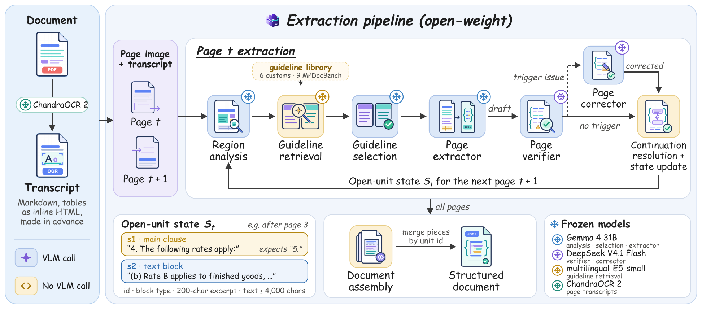
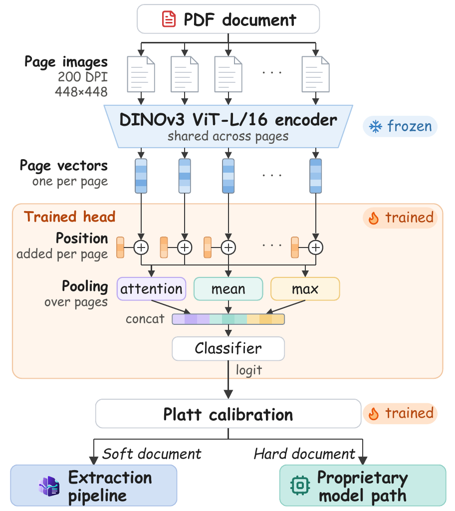

# DocRelay

DocRelay extracts long, visually complex documents page by page into structured units. This repository has the
pipeline and its evaluation on two datasets: TIDE (Bangladeshi customs documents in Bangla, English and code-mixed
text) and MPDocBench-Parse (English and Chinese).



The pipeline reads one page at a time. On each page, the page extractor drafts the blocks, and the page verifier and
page corrector check and repair the draft. Only the open-unit state, the units that may continue on the next page,
passes from one page to the next. After the last page, document assembly merges the pieces of each unit, so a
paragraph, numbered item or table that crosses a page break becomes one unit.

| Stage                                                    | Code (`src/`)                                                                | Model                 |
| -------------------------------------------------------- | ------------------------------------------------------------------------------ | --------------------- |
| Page transcript (made in advance)                        | `ocr/generate/chandra_ocr.py` (TIDE), `scripts/ocr_images.py` (MPDocBench) | ChandraOCR 2          |
| Region analysis                                          | `stages/region_analyzer.py`                                                  | Gemma 4 31B           |
| Guideline retrieval (top 2)                              | `registry/skill_retriever.py`, guidelines in `skills/records/`             | multilingual-E5-small |
| Guideline selection                                      | `stages/skill_router.py`                                                     | Gemma 4 31B           |
| Page extractor                                           | `stages/extractor.py`                                                        | Gemma 4 31B           |
| Page verifier                                            | `stages/super_validator.py`                                                  | DeepSeek V4.1 Flash   |
| Page corrector (only when the verifier reports an issue) | `stages/final_decider.py`                                                    | DeepSeek V4.1 Flash   |
| Continuation resolution and state update                 | `core/orchestrator.py`, `stages/carry_builder.py`                          | none                  |
| Document assembly                                        | `stages/assembler.py`                                                        | none                  |

Settings are in `config/pipeline.yaml` and `config/models.yaml`, prompts in `prompts/`, output schemas in `schemas/`.

## Difficulty router (optional)



The router runs before extraction and sends documents predicted to be hard to a proprietary model (Gemini 3.1 Pro);
all others go to the extraction pipeline. A frozen DINOv3 ViT-L/16 encoder embeds each page, a small trained head
adds each page's position and pools the pages, and Platt scaling calibrates the probability that the document is
hard. Documents at or above the threshold (0.43) are routed.

## Repository layout

```
DocRelay-code/
├── requirements.txt        pipeline and evaluation (Python 3.11)
├── requirements-ocr.txt    only for making OCR (GPU)
├── .env.example            OPENROUTER_API_KEY
├── data/README.md          where the datasets go (no data is shipped)
├── tide/                   TIDE pipeline and evaluation, entry point run.py
├── mpdocbench/             MPDocBench-Parse pipeline and evaluation, entry point run.py
└── router/                 difficulty router, entry point router.py
```

`tide/` and `mpdocbench/` have the same layout (`config/ prompts/ schemas/ skills/ src/ tests/`) and are
self-contained.

## Setup

```bash
python -m venv .venv && source .venv/bin/activate
pip install -r requirements.txt
pip install -r requirements-ocr.txt      # only to make OCR (needs a GPU)
pip install -r router/requirements.txt   # only for the router
cp .env.example .env                     # then set OPENROUTER_API_KEY
```

Language models are called through OpenRouter, billed to your key. Put the datasets in `data/` as described in
[`data/README.md`](data/README.md).

## Run

Each `run.py` is configured by the globals at its top; there is no command line.

**TIDE**

```bash
python tide/run.py
```

`RUN_OCR` makes the OCR, `RUN_PIPELINE` extracts the documents, `RUN_EVAL` scores them. Results go to
`tide/runs/<RUN_ID>/`: `<doc>/<model>/final_document.json` per document and `_eval/paper_metrics.json` for the paper
metrics (Text Edit, Table TEDS, C-P, C-P precision / recall / F1).

**MPDocBench-Parse**

```bash
python mpdocbench/scripts/ocr_images.py   # once, needs a GPU
python mpdocbench/run.py
```

**Difficulty router (optional)**

```bash
python router/router.py batch --dir <pdf_folder> --output routes.csv
```

Each document is labelled `HARD` (send it to the proprietary model) or `SOFT` (run the pipeline). Put the `SOFT`
documents, by file name without `.pdf`, in `DOCUMENTS` in `tide/run.py`. [`router/README.md`](router/README.md)
covers single-file use, a high-recall mode and the Python API.

## Tests

Unit tests check the code (OCR reading, output schemas, cross-page merging, document assembly, the metrics and the
router) on small synthetic inputs. They need no PDFs and make no model calls.

```bash
(cd tide && python -m pytest)
(cd mpdocbench && python -m pytest)
(cd router && python -m unittest discover -s tests)
```

## Licences

Gemma, DeepSeek, multilingual-E5, ChandraOCR 2 and DINOv3 each have their own licence. The official MPDocBench code
is Apache-2.0.
